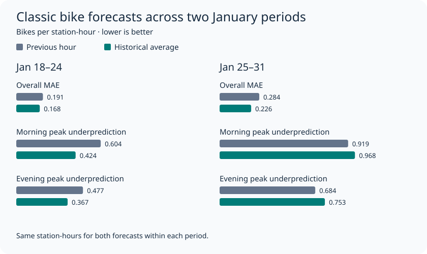
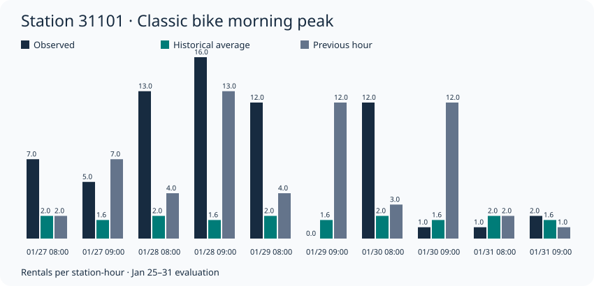

# Capital Bikeshare｜站點使用分析與尖峰借車量預測

以華盛頓特區及周邊的 Capital Bikeshare 旅次資料，評估一般自行車下一小時借車量能否作為尖峰補車排序的輸入。

## 主要結果



用 1 月 1–17 日的一般車紀錄選站、定義各站尖峰並估計歷史平均。按時間比較兩段評估期，在相同站點小時比較「上一小時」與「同站、同日型、同小時歷史平均」。表中數字依序為上一小時 → 歷史平均，單位為每站每小時借車次數。

| 評估期間 | 整體 MAE | 早尖峰平均低估量 | 晚尖峰平均低估量 |
|---|---:|---:|---:|
| 1/18–24 | 0.191 → **0.168** | 0.604 → **0.425** | 0.477 → **0.367** |
| 1/25–31 | 0.284 → **0.226** | **0.919** → 0.968 | **0.684** → 0.753 |

歷史平均兩段整體 MAE 都較低。月底尖峰低估反而增加，顯示整體準確度與尖峰補車優先關心的低估可能有取捨。平均低估量是所有評估格的 max(實際量 − 預測量, 0) 平均。這是單月觀測量比較，空站率與調度效果需要庫存和營運資料。缺事件的站點小時暫填零，營運涵蓋仍待核對。

## 站點案例：月底早尖峰低估集中在哪裡



在 216 個納入評估的早尖峰站點中，歷史平均的累計低估量在 93 站較高、118 站較低、5 站相同。全體淨增加 105.36 次低估，主要的正差出現在 1/28 和 1/29。前五站合計占所有低估增加站點正向差額的 23.55%，顯示差距未集中在少數站。

31101 站是事後挑出的差距最大案例。1/28 09:00–09:59 實際借出 16 台一般車，歷史平均預測 1.64 台，上一小時基準預測 13 台，低估分別為 14.36 和 3 台。前一小時的借車量在這一格提供了較強的訊號；是否應據此調度仍需站點庫存和還車資訊。此案例用於解釋評估結果。[站點案例 Notebook](notebooks/12_classic_peak_case.ipynb)

## 資料品質與統計口徑

原始月檔共 285,731 筆、13 欄，無重複旅次 ID、時間解析失敗或非正時長。短於一分鐘及超過 24 小時的旅次保留供複查。借出月份以檔案中的借出時間判定，時區尚待確認。

- 一月借出的一般車 78,942 筆皆有起站 ID。電輔車 206,753 筆中有 88,110 筆缺起站 ID（42.62%）。
- 全系統電輔車借出量包含未歸站旅次。站點分析只使用有起站 ID 的 118,643 筆。兩者逐日對回原始總量，共 31 天。
- 在一般平日 08:00–08:59 的電輔車樣本，缺 ID 組座標 4,471/4,471 落在兩位小數網格，有 ID 組為 0/7,100。模擬兩位小數取整並擴大候選站來源後，3,480 筆缺 ID 旅次仍對應多站。候選站依賴樣本涵蓋及取整假設，因此未把候選站當作真實起站。

## 建議閱讀順序

1. [資料健檢](notebooks/01_data_check.ipynb) → [SQLite 與 pandas 對帳](notebooks/02_station_hour.ipynb)
2. [起站缺漏](notebooks/06_station_missingness.ipynb) → [座標歧義](notebooks/09_coordinate_grid_check.ipynb) → [候選範圍敏感度](notebooks/10_candidate_coverage.ipynb) → [電輔車逐日對帳](notebooks/11_ebike_borrow_reconciliation.ipynb)
3. [一般車尖峰基準](notebooks/07_classic_peak_baseline.ipynb) → [月底複核](notebooks/08_classic_end_month_check.ipynb)

## 資料來源
- [Capital Bikeshare System Data](https://capitalbikeshare.com/system-data)
- [Capital Bikeshare Data License Agreement](https://capitalbikeshare.com/data-license-agreement)
- [2025 年 1 月官方 ZIP](https://s3.amazonaws.com/capitalbikeshare-data/202501-capitalbikeshare-tripdata.zip)

授權條款限制以獨立資料集再散布。原始 ZIP 放在 data/raw，由讀者自行下載。Notebook 只輸出摘要，保留 ZIP 原樣。

## 重現

從本目錄以 Python 3.12 執行：

```sh
python3 -m venv .venv
source .venv/bin/activate
python -m pip install -r requirements.txt
mkdir -p data/raw
curl -fL https://s3.amazonaws.com/capitalbikeshare-data/202501-capitalbikeshare-tripdata.zip -o data/raw/202501-capitalbikeshare-tripdata.zip
jupyter nbconvert --to notebook --execute --inplace notebooks/01_data_check.ipynb
```

如要重跑其他 Notebook，把最後一行的路徑改成對應檔案。各 Notebook 可獨立執行，讀取官方 ZIP，執行目錄為 Notebook 所在的資料夾。

## 第一階段執行結果

已下載官方 ZIP、檢查壓縮檔完整性並執行 [資料健檢 Notebook](notebooks/01_data_check.ipynb)。實讀 285,731 筆、13 欄。ZIP SHA-256 為 `d1bb7539d0a2b016bfdce2bc3db60b801869948ecf5139a32f897422ee6d312e`。

- ride_id 缺漏與重複皆為 0。起訖時間解析失敗皆為 0。
- 負時長與零時長皆為 0。5,899 筆大於零且不足 1 分鐘，190 筆超過 24 小時。這些是待複查旗標。
- 起站 ID 缺 88,122 筆，迄站 ID 缺 91,217 筆，兩端都缺 60,381 筆。兩端 ID 都存在的有 166,773 筆。
- 最早起始時間落在 2024-12-31。聚合前需依每一端事件時間定義月份及確認時區。
- 站點 ID 有值只代表欄位完整。後續才核對站表、營運時間及資料涵蓋。本階段尚未推定缺漏原因。

## 第二階段：站點小時彙總

執行 [02_station_hour.ipynb](notebooks/02_station_hour.ipynb) 的所有程式格。SQLite 與 pandas 的 200,556 個分組逐組一致，合計 571,426 件事件。借車有 197,585 件可歸站、88,110 件站點未知；還車分別是 194,514 和 91,217 件。按借還事件各自的時間篩選，36 件跨月借車不納入一月，其一月還車仍納入。

目前只有觀測到事件的分組，未補站點小時零值，也未推定站點。下一步是定義可觀測的站點小時與預測目標，再建立基準。

## 第三階段：觀測借車量基準

[03_borrow_baseline.ipynb](notebooks/03_borrow_baseline.ipynb) 用 1–24 日選出 762 個站，保留 25–31 日的 128,016 個站點小時評估。未出現在選站期間的站點，測試週有 30 件借車不納入評分。資料以檔案時間切分。

測試網格有 77.52% 為零。全猜零的 MAE 為 0.5057；用同站上一小時的觀測量預測，MAE 為 0.4950。只看實際有借車的時段，兩者分別為 2.2498 和 1.5790。暫填零依賴站點覆蓋假設，尚無營運資料核對。下一輪可在訓練期間保留驗證時段，再比較同星期同小時基準或模型；本次測試週結果已看過，後續定稿宜另留未使用的時間區段。

## 第四階段：日型基準與尖峰驗證

[04_peak_baseline.ipynb](notebooks/04_peak_baseline.ipynb) 保存 1–17 日訓練、18–24 日驗證的整體及站點尖峰比較，以及 3、5、7 天納入門檻的敏感度分析。

## 第五階段：Poisson 模型比較

[05_poisson_comparison.ipynb](notebooks/05_poisson_comparison.ipynb) 在相同驗證格比較歷史平均與計數模型。後續營運指標為尖峰空站率，同時報告未加權版本與以訓練期站點尖峰借車量為權重的版本。須取得歷史庫存才可評估。

## 第六階段：起站 ID 缺漏診斷

[06_station_missingness.ipynb](notebooks/06_station_missingness.ipynb) 用 SQLite 比較車種、日型與小時的起站 ID 缺漏率。分組合計核對為 285,695 件一月借車，其中 88,110 件缺起站 ID。缺漏集中於電輔車，原因仍待核對。
